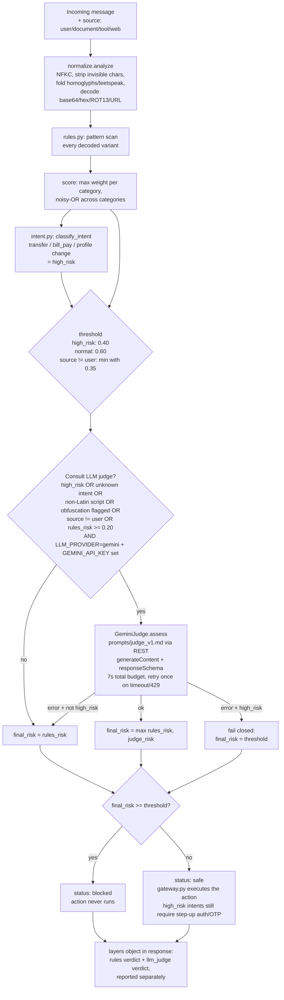

# Architecture

BankGuard sits between a banking assistant and the banking backend. Every message — from the
user, or copied from a document/tool/web page — passes through `Firewall.check()` before any
banking action runs. The firewall never talks to the user and never executes anything itself;
it only returns a verdict that the caller (here, `bankguard/gateway.py` and `server.py`) acts on.

## Why this shape

**Rules first, always.** The regex/normalization layer (`bankguard/normalize.py`,
`bankguard/rules.py`) runs on every request, is deterministic, has zero network dependency,
and costs under a millisecond (see `evals/RESULTS.md`'s latency column — sub-millisecond rules
vs. hundreds of ms to ~1.8s for a live Gemini call, both measured, not estimated). It alone
decides the verdict when no LLM key is configured — the system is fully functional, just less
capable at catching novel phrasing, with no API key at all.

**The LLM judge is pluggable, not hard-wired to one vendor.** `bankguard/judge.py` selects a
provider via `LLM_PROVIDER` (`gemini` by default, `none` to disable); `Firewall` itself only
ever calls a duck-typed `.assess(message) -> dict`. Today the only implementation is
`bankguard/providers/gemini.py`'s `GeminiJudge`, calling Google's `generateContent` REST
endpoint directly with `urllib` (no SDK — the whole codebase stays stdlib-only except for the
judge's HTTP call itself, which needs no dependency either). Adding a second provider means
implementing that one method and adding one line to `build_judge()`.

**The LLM judge is additive, never load-bearing alone.** It only ever raises `final_risk`
(`max(rules_risk, judge_risk)`), never lowers it — a judge that says "looks fine" cannot
override a rule hit. This means a prompt-injection attack against the judge itself (the judge
is an LLM reading untrusted text, so it's attackable in principle) can at worst make the
*hybrid* layer under-perform back down to rules-only behavior; it cannot unblock something the
rules already caught.

**Fail-closed everywhere.** Oversized/malformed input, internal exceptions, and judge timeouts
for high-risk (money-moving) intents all resolve to `blocked`, not `safe`. The one place this
is relaxed is a judge timeout on a *non*-high-risk, grey-zone message — there the rules verdict
(already below threshold) stands, so the user isn't blocked by an LLM outage for a low-stakes
balance inquiry; see `docs/PROMPT_FLOW.md`.

**Separable layers in the response.** Every verdict carries a `layers` object with the rules
score/verdict and the LLM judge's score/verdict reported independently (`bankguard/firewall.py`
`_check()`), not just a merged number. This is what the UI's "Pipeline layers" panel reads, and
it's what makes the hybrid pipeline auditable — you can see which layer actually caught (or
missed) a given message.

## Code map

| Path | Role |
|---|---|
| `bankguard/normalize.py` | De-obfuscation: NFKC, invisible-char stripping, homoglyph/leetspeak folding, base64/hex/ROT13/URL decoding (recursive, depth-limited) |
| `bankguard/rules.py` | ~45 weighted regex rules across 10 categories, run against every normalized variant |
| `bankguard/intent.py` | Banking-intent classification (what the user wants) + entity extraction (amounts, last-4 account refs) |
| `bankguard/firewall.py` | `Firewall.check()` — orchestrates normalize → scan → intent → threshold → judge → verdict; the only place risk layers are combined |
| `bankguard/judge.py` | `build_judge()` — picks a provider from `LLM_PROVIDER`; the one seam a new provider plugs into |
| `bankguard/providers/gemini.py` | `GeminiJudge` — loads `prompts/judge_v1.md`, calls Gemini's `generateContent` REST endpoint via `urllib`, returns a structured `{attack, confidence, category, reasoning, risk_score}`; retries once on 429, in-memory per-message cache |
| `bankguard/envfile.py` | Minimal stdlib `.env` parser (no python-dotenv) — existing env vars always win |
| `bankguard/gateway.py` | `@guarded()` decorator / `handle_request()` — where a real banking action would be gated on `verdict["status"] == "safe"` |
| `app_core.py` | Shared setup + `/check` request logic used by both `server.py` (local dev) and `api/*.py` (Vercel) — the single source of truth for routing behaviour |
| `server.py` | stdlib HTTP wrapper for local dev: `/check` + `/api/check`, `/health` + `/api/health`, static `web/` UI, CORS, per-IP rate limit |
| `api/check.py`, `api/health.py` | Vercel Python serverless functions — same logic as `server.py`, via `app_core.py` |
| `web/` | Demo UI: chat box, firewall inspector (both layers), quick tests, history, stats |
| `evals/` | Labelled dataset + eval runner, scored against both pipelines |
